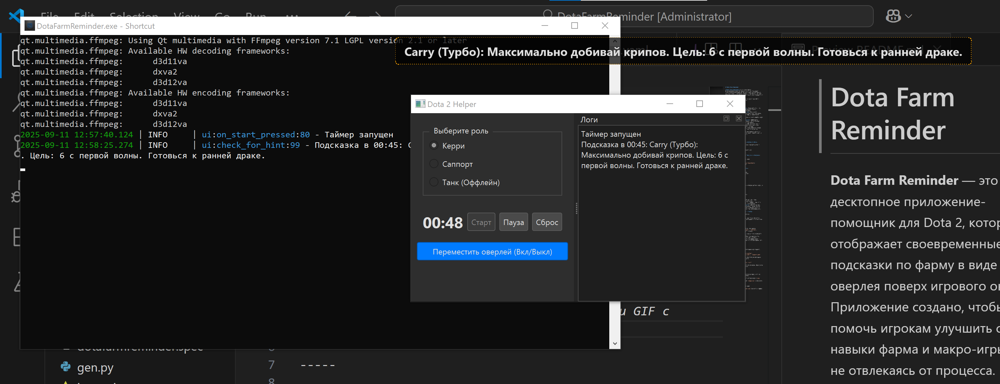

# Dota Farm Reminder

**Dota Farm Reminder** — это десктопное приложение-помощник для Dota 2, которое отображает своевременные подсказки по фарму в виде оверлея поверх игрового окна. Приложение создано, чтобы помочь игрокам улучшить свои навыки фарма и макро-игры, не отвлекаясь от процесса.



-----

##  Ключевые возможности

  - **Подсказки для каждой роли**: Выбирайте свою роль (Carry, Support, Offlane) и получайте советы, релевантные именно для вашей позиции.
  - **Полная концентрация на фарме**: Все советы сфокусированы на улучшении экономики: контроле линии, таймингах для леса, целях по крипам и эффективных ротациях.
  - **Режим "Турбо"**: Все тайминги и советы адаптированы под быстрый темп Turbo-режима.
  - **Управление горячими клавишами**: Запускайте, останавливайте и сбрасывайте таймер, не сворачивая игру, с помощью глобальных горячих клавиш.
  - **Настраиваемый оверлей**: Полупрозрачное окно с подсказками не перекрывает клики мыши и его можно переместить в любую удобную часть экрана.
  - **Звуковые уведомления**: Короткий звуковой сигнал оповестит о новой подсказке, чтобы вы ничего не пропустили.
  - **Полная кастомизация**: Все подсказки хранятся в простых `.yaml` файлах, которые легко редактировать и настраивать под свой стиль игры.

-----

##  Установка

Для работы приложения необходим **Python 3.10+**.

1.  **Клонируйте репозиторий** (или скачайте архив с кодом):

    ```bash
    git clone <адрес-вашего-репозитория>
    cd DotaFarmReminder
    ```

2.  **Создайте и активируйте виртуальное окружение**:

    ```bash
    # Создаем окружение в папке .venv
    python -m venv .venv

    # Активируем его (для Windows PowerShell)
    .\.venv\Scripts\Activate.ps1
    ```

3.  **Установите все зависимости**:

    ```bash
    # Используйте стандартный pip
    pip install -r requirements.txt
    ```

-----

##  Как использовать

### 1\. Запуск приложения

Убедитесь, что ваше виртуальное окружение активировано, и выполните команду:

```bash
python main.py
```

Откроется главное окно приложения.

### 2\. Интерфейс

  - **Выбор роли**: Выберите одну из трех ролей. Подсказки будут загружены автоматически.
  - **Кнопки управления**: "Старт", "Пауза", "Сброс" в окне работают так же, как и горячие клавиши.
  - **Кнопка "Переместить оверлей"**: Нажмите на нее, чтобы активировать режим перемещения. Рамка оверлея станет оранжевой. Установите его в удобное место и отожмите кнопку, чтобы он снова стал некликабельным.

### 3\. Горячие клавиши (работают всегда)

  - **`F8`** — Старт / Пауза таймера.
  - **`F9`** — Сброс таймера.

Нажмите **`F8`** в начале матча, как только появятся крипы. Приложение начнет давать подсказки в соответствии с таймером.

-----

##  Как это работает

Проект имеет модульную архитектуру, где каждый "компонент" (`timer`, `hint_manager`, `overlay`, `settings`) отвечает за свою часть логики.

  - **`main.py`** и **`ui.py`** собирают все компоненты вместе и управляют интерфейсом.
  - **`containers.py`** настраивает все зависимости, чтобы компоненты могли общаться друг с другом.
  - **`hint_manager/config/`**: В этой папке лежат `.yaml` файлы, из которых загружаются все подсказки. Это сердце приложения.

-----

##  Кастомизация подсказок

Вы можете легко изменить любые подсказки или добавить свои.

1.  Откройте папку `hint_manager/config/`.
2.  Выберите нужный файл (`carry.yaml`, `support.yaml` или `offlane.yaml`).
3.  Измените текст или тайминги существующих подсказок или добавьте новые в том же формате:
    ```yaml
    - time: "ЧЧ:ММ"
      text: "Ваш новый гениальный совет"
    ```
4.  Сохраните файл и перезапустите приложение. Ваши новые подсказки загрузятся автоматически.

-----

##  Сборка в `.exe` файл

Если вы хотите создать один исполняемый файл, который будет работать без установки Python:

1.  Убедитесь, что все зависимости установлены (`pip install -r requirements.txt`).
2.  (Опционально) Создайте иконку `image.ico` и положите ее в корень проекта.
3.  Выполните команду сборки:
    ```bash
    pyinstaller dotafarmreminder.spec
    ```
4.  Готовый файл `DotaFarmReminder.exe` появится в папке `dist`.

-----
