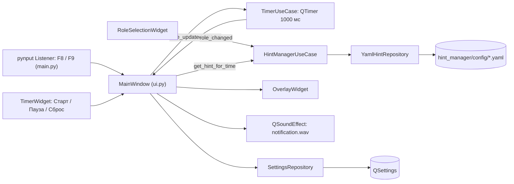

# DotaFarmReminder — документация

DotaFarmReminder — настольное приложение на Python и PyQt6 для Dota 2. Пользователь запускает
таймер в начале матча, и в заданные моменты (минуты:секунды от запуска таймера) поверх остальных
окон на 5 секунд появляется текстовая подсказка для выбранной роли — Carry, Support или Offlane —
и звучит сигнал. Подсказки лежат в YAML-файлах `hint_manager/config/`, каждая подписана
«(Турбо)», то есть рассчитана на режим Turbo. С игрой приложение не связано: время отсчитывается
от нажатия «Старт» или F8. Корневой [README](../README.md) обращается к игрокам, которые хотят
улучшить фарм и макро-игру; кто конкретно пользуется приложением, в файлах не сказано.

Требования, восстановленные по коду: [SPEC.md](../SPEC.md).

## Состояние

- Последний коммит собственного кода — `f2519ba`, 2026-08-01: добавлен пустой `timer/__init__.py`.
  По сообщению коммита, без него `import timer` находил модуль `timer` из pywin32, и `main.py`
  падал при старте. Тексты подсказок последний раз менялись 2025-09-11 (`43f5281`). Последний
  коммит в репозитории — `bd893bd`, 2026-08-05, файл `LICENSE` (MIT) и строка `.env` в `.gitignore`.
- Тесты: в `timer/`, `hint_manager/`, `overlay/`, `settings/` лежит по одному `tests.py` с
  единственным тестом `assert True`. Это заготовки из `gen.py`, поведение они не проверяют.
- CI нет: каталогов `.github/` и `.gitea/` нет. Инструментов repo-quality-template (`recipe.ps1`,
  `.claude/`, `.pre-commit-config.yaml`) тоже нет.
- Что не доделано (видно по коду):
  - `overlay/application.py`, `overlay/domain.py`, `overlay/infrastructure.py`,
    `settings/application.py`, `settings/domain.py`, `settings/ui.py`, `timer/infrastructure.py` —
    заготовки генератора (в части из них стоит `# TODO`), ни один работающий модуль их не импортирует;
  - `timer/infrastructure.py` не импортируется вообще: `ImportError: cannot import name
    'ITimerRepository'`, потому что `timer/domain.py` такого класса не объявляет (проверено импортом);
  - `timer/config/timer.yaml`, `overlay/config/overlay.yaml`, `settings/config/settings.yaml`
    содержат шаблонные `param1: value1` и никем не читаются;
  - `pytest-benchmark` есть в `requirements.txt`, но нигде не используется; `image.ico` и
    `mixkit-long-pop-2358.wav` лежат в корне, но ни код, ни spec-файл на них не ссылаются.

## Структура

| Путь | Что это |
|---|---|
| `main.py` | точка входа: DI-контейнер, журнал, стиль Fusion с тёмной темой, глобальные клавиши F8/F9 |
| `containers.py` | контейнер `dependency_injector`: синглтоны репозиториев, use case'ов и главного окна |
| `ui.py` | `MainWindow`: собирает виджеты, связывает сигналы, показывает подсказки, сохраняет и восстанавливает положение окон |
| `timer/` | `TimerState`, `TimerUseCase` (QTimer, шаг 1 с, сигнал `time_updated` со строкой `MM:SS`), `TimerWidget` (время и кнопки Старт/Пауза/Сброс) |
| `hint_manager/` | `Hint`, `HintState`, `YamlHintRepository`, `HintManagerUseCase`, `RoleSelectionWidget` (три радиокнопки ролей) |
| `hint_manager/config/carry.yaml`, `support.yaml`, `offlane.yaml` | подсказки: 20, 17 и 17 записей `time`/`text` |
| `overlay/ui.py` | `OverlayWidget`: окно без рамки поверх остальных, полупрозрачная подложка, режим перетаскивания |
| `settings/infrastructure.py` | `SettingsRepository` поверх `QSettings` |
| `gen.py` | генератор каркаса нового компонента |
| `dotafarmreminder.spec` | спецификация сборки PyInstaller |
| `notification.wav` | звук подсказки |
| `image-1.png`, `image.png` | снимок экрана для README; иконка в spec-файле |
| `requirements.txt` | список зависимостей без версий |

## Архитектура

Каждый компонент разложен по слоям `domain` / `application` / `infrastructure` / `ui` — так их
создаёт `gen.py`. Работающая часть показана на схеме; сборка объектов — `containers.py`, порядок
запуска — `main.py:52-87`.



Поток данных:

1. `main()` кладёт в конфигурацию контейнера путь `hint_manager/config` рядом с `main.py`
   (`main.py:55-57`), настраивает loguru (`main.py:12-29`), создаёт `QApplication` со стилем Fusion
   и тёмной таблицей стилей (`main.py:61-78`), показывает главное окно и запускает слушатель
   клавиатуры (`main.py:80-83`).
2. `HintManagerUseCase` при создании загружает подсказки роли `support`
   (`hint_manager/domain.py:11`, `hint_manager/application.py:8`). Выбор другой радиокнопки
   загружает файл `<роль>.yaml` (`hint_manager/application.py:10-16`, `hint_manager/infrastructure.py:11`).
3. Раз в секунду `TimerUseCase` прибавляет секунду и шлёт строку `MM:SS`
   (`timer/application.py:13-15`). `MainWindow.check_for_hint` ищет подсказку с точно таким же
   `time` (`ui.py:93-94`, `hint_manager/application.py:18-24`).
4. Найденный текст показывается в оверлее, звучит `notification.wav` (если загрузился), текст
   пишется в журнал, через 5000 мс оверлей скрывается (`ui.py:96-100`).
5. При закрытии главного окна в `QSettings` сохраняются позиция оверлея, геометрия и состояние окна
   (`ui.py:102-106`); при следующем запуске они восстанавливаются (`ui.py:109-118`).

Внешние системы: сетевых вызовов и чтения состояния игры в коде нет. Импортируются только PyQt6
(включая QtMultimedia), pynput, loguru, PyYAML, dependency_injector, pytest (в заготовках
`tests.py`) и стандартная библиотека.

## Сборка и запуск

Требования:

- Python 3.10+ (`../README.md:23`). Код использует аннотации вида `str | None`
  (`hint_manager/application.py:18`), а этот синтаксис появился в 3.10.
- Пакеты из `requirements.txt:1-8`: PyQt6, pytest, pytest-benchmark, PyYAML, loguru, pynput,
  dependency-injector, pyinstaller. Версии не закреплены, lock-файла нет.
- ОС: spec-файл подключает `pynput.keyboard._win32` и `pynput.mouse._win32`
  (`dotafarmreminder.spec:13-14`), команды README даны для PowerShell. Другие ОС не описаны и не
  проверялись.

Установка (`../README.md:35-46`):

```powershell
python -m venv .venv
.\.venv\Scripts\Activate.ps1
pip install -r requirements.txt
```

Запуск (`../README.md:58`):

```powershell
python main.py
```

Сборка (`../README.md:111`):

```powershell
pyinstaller dotafarmreminder.spec
```

О сборке по содержимому spec-файла (сама сборка не запускалась): `EXE(..., exclude_binaries=True)`
вместе с `COLLECT(...)` (`dotafarmreminder.spec:26-53`) — это вариант PyInstaller «папка»
(onedir), поэтому ожидаемый результат — каталог `dist/DotaFarmReminder/` с
`DotaFarmReminder.exe` внутри, а не один файл, как написано в `../README.md:105` и `:113`.
`console=True` (`:36`) — рядом с окном приложения открывается консоль. Иконка — `image.png`
(`:42`), а не `image.ico`, о котором говорит `../README.md:108`. В сборку включены
`hint_manager/config` и `notification.wav` (`:7-10`).

## Конфигурация

Собственных переменных окружения и флагов командной строки нет; `sys.argv` передаётся только в
`QApplication` (`main.py:61`). Все параметры заданы в коде:

| Параметр | Источник | Значение |
|---|---|---|
| Каталог подсказок | `main.py:55-57` | `<каталог main.py>/hint_manager/config` |
| Файл подсказок роли | `hint_manager/infrastructure.py:11` | `<роль в нижнем регистре>.yaml`: `carry`, `support`, `offlane` |
| Роль при запуске | `hint_manager/domain.py:11`, `hint_manager/ui.py:26` | `support`; выбор роли между запусками не сохраняется |
| Звук подсказки | `ui.py:32-36` | `<каталог ui.py>/notification.wav`; если файла нет — предупреждение в журнал, звука нет |
| Время показа подсказки | `ui.py:100` | 5000 мс |
| Шаг таймера | `timer/application.py:20` | 1000 мс |
| Горячие клавиши | `main.py:38-44` | F8 — старт/пауза, F9 — сброс |
| Файл журнала | `main.py:13-28` | `logs/dota2helper/<ГГГГ-ММ-ДД>.log` относительно текущего каталога; JSON-строки, ротация 10 MB, хранение 10 дней, сжатие zip |
| Другие приёмники журнала | `main.py:18`, `ui.py:65` | stderr и панель «Логи», уровень INFO |
| Сохранённое состояние | `settings/infrastructure.py:4-23` | `QSettings("MyCompany", "Dota2Helper")`, ключи `mainWindow/geometry`, `mainWindow/state`, `overlay/position` |

Формат файла подсказок (`hint_manager/infrastructure.py:14-16`, `hint_manager/domain.py:4-7`):

```yaml
- time: "05:30"
  text: "Текст подсказки"
```

- Файл — список; у каждого элемента ровно два ключа, `time` и `text` (элемент передаётся в
  `Hint(**item)`). Лишний ключ даёт `TypeError` (проверено).
- Пустой файл даёт `TypeError: 'NoneType' object is not iterable` (проверено). Отсутствующий файл —
  пустой список подсказок (`hint_manager/infrastructure.py:12-13`).
- `time` сравнивается как строка со строкой таймера `MM:SS`; минуты не ограничены 59
  (`timer/domain.py:8-10`), поэтому `"60:00"` срабатывает через 3600 с после старта таймера.
- `time` нужно брать в кавычки: PyYAML читает `10:00` без кавычек как число 600 (проверено
  `yaml.safe_load`), и такая подсказка никогда не совпадёт.
- В `../README.md:96` формат назван «ЧЧ:ММ»; по коду это минуты и секунды от запуска таймера.

## Использование

Матч. Запустить `python main.py`, выбрать роль в блоке «Выберите роль». При появлении крипов
нажать F8 (`../README.md:74`) или «Старт». В моменты из файла роли оверлей показывает подсказку
5 секунд со звуком, строка дублируется в панель «Логи». F8 ещё раз — пауза, F9 или «Сброс» —
таймер обнуляется до `00:00`, оверлей скрывается (`ui.py:87-91`).

Перемещение оверлея. Нажать «Переместить оверлей (Вкл/Выкл)»: у текста появляется пунктирная
оранжевая рамка, оверлей принимает мышь, его можно тащить левой кнопкой (`overlay/ui.py:39-60`).
Повторное нажатие выключает режим. По коду кнопка не показывает оверлей сама (`ui.py:47`,
`overlay/ui.py:39-52`), а виден он только 5 секунд после подсказки — перетаскивать можно только в
это время. Позиция сохраняется при закрытии главного окна.

Свои подсказки. Отредактировать `hint_manager/config/<роль>.yaml` по формату выше и
перезапустить приложение (`../README.md:88-99`) — файлы читаются при создании use case'а и при
смене роли, без отслеживания изменений.

Новый компонент. `python gen.py <ComponentName>` (`gen.py:103-108`) создаёт каталог с `domain.py`,
`application.py`, `infrastructure.py`, `ui.py`, `config/<имя>.yaml`, `tests.py`. Если каталог уже
есть, печатает ошибку и ничего не пишет. `__init__.py` генератор не создаёт — именно его пришлось
добавить в `timer/` вручную (`f2519ba`).

## Тестирование

Конфигурации pytest в репозитории нет, команд запуска тестов в файлах проекта тоже. Что показали
запуски при написании этого документа:

- `python -m pytest --collect-only -q` — `no tests collected`: имена `tests.py` не подходят под
  шаблон pytest по умолчанию `test_*.py` / `*_test.py`.
- `python -m pytest -q hint_manager/tests.py overlay/tests.py settings/tests.py timer/tests.py` —
  ошибка сбора `import file mismatch`: три из четырёх каталогов без `__init__.py`, и все модули
  называются `tests`.
- Тот же набор с `--import-mode=importlib` — `4 passed`. Все четыре теста — `assert True`.

Покрытия поведения нет. Загрузку и поиск подсказок я проверил отдельным скриптом вне репозитория
(см. «Об этом документе»); GUI, таймер на Qt и клавиши не проверялись.

## Известные ограничения и проблемы

- Таймер не связан с игровыми часами: его запускают и ставят на паузу вручную; пауза в игре
  таймер не останавливает.
- Обработчик F8/F9 выполняется в потоке слушателя pynput и напрямую вызывает методы главного окна,
  которые запускают и останавливают `QTimer` и меняют виджеты (`main.py:36-44`, `ui.py:77-91`).
  Qt требует запускать таймер из потока, которому он принадлежит. Работают ли клавиши на деле —
  не проверено (PyQt6 здесь не установлен, приложение не запускалось); это подозрение, не замер.
- Клавиши F8 и F9 не перехватываются: `keyboard.Listener` создаётся без `suppress`
  (`main.py:48`), нажатие доходит и до игры.
- Оверлей ставит только `WA_TransparentForMouseEvents` (`overlay/ui.py:37`); флага окна
  `WindowTransparentForInput` нет. Проходят ли клики сквозь оверлей в окно игры, как обещает
  `../README.md:15`, не проверено.
- Ошибка в YAML (пустой файл, лишний ключ) роли `support` при запуске перехватывается в `main()`:
  запись в журнал и выход с кодом 1 (`main.py:88-90`). Та же ошибка при смене роли возникает в
  слоте Qt; что тогда происходит, не проверено.
- Выбранная роль не сохраняется: после перезапуска снова `support`.
- Пути к подсказкам и звуку строятся от `__file__` (`main.py:56`, `ui.py:32`), путь журнала — от
  текущего каталога (`main.py:13`). Находит ли собранный exe свои файлы, не проверено; снимок
  `image-1.png` (коммит `15375c0`, 2025-09-11) показывает консоль `DotaFarmReminder.exe` и
  подсказку Carry на `00:45`, то есть сборка того дня подсказки находила. Про звук снимок не говорит.
- В коде остались прежние имена: заголовок окна «Dota 2 Helper» (`ui.py:28`), каталог журнала
  `dota2helper`, организация `MyCompany` в `QSettings` (`settings/infrastructure.py:4`).
- Расхождения корневого README с кодом: «один исполняемый файл» против сборки в каталог, `image.ico`
  против `image.png`, «ЧЧ:ММ» против `MM:SS` (подробно выше).
- Интерфейс (кроме заголовка окна) и подсказки только на русском.

## Связанные документы

- [README проекта](../README.md) — установка, использование, сборка (на русском).
- [SPEC.md](../SPEC.md) — требования, восстановленные по коду.
- [LICENSE](../LICENSE) — лицензия MIT.

## Об этом документе

Написан 2026-11-18 по коммиту `bd893bd` (ветка `docs/spec-and-docs` от `origin/dev`).

Запускалось (интерпретатор машины: Python 3.13.3, pytest 9.1.1, PyYAML 6.0.2; PyQt6, pynput,
loguru и dependency-injector не установлены):

- `git ls-files`, `git log`, `git show --stat f2519ba 55ffd31 43f5281`;
- три запуска pytest из раздела «Тестирование» (с `-p no:cacheprovider`, без записи `__pycache__`);
- `import timer.infrastructure` — `ImportError` по `ITimerRepository`;
- `TimerState(seconds=3600).formatted_time()` — `60:00`, `TimerState(seconds=59)` — `00:59`;
- скрипт вне репозитория над настоящими `hint_manager/config/*.yaml`: роль по умолчанию `support`,
  17 подсказок, `01:00` находится; `carry` — 20 подсказок, `00:45` находится, `00:46` — нет;
  неизвестная роль — пустой список; пустой файл и лишний ключ — `TypeError`; во всех трёх файлах
  времена уникальны, в формате `MM:SS`, идут по возрастанию, каждый текст начинается с
  «<Роль> (Турбо):»; `yaml.safe_load` читает `10:00` без кавычек как `600`.

Не запускалось: `python main.py` (нет зависимостей, и запуск приложения не входил в задачу),
`pip install`, `pyinstaller dotafarmreminder.spec`, `python gen.py`.
